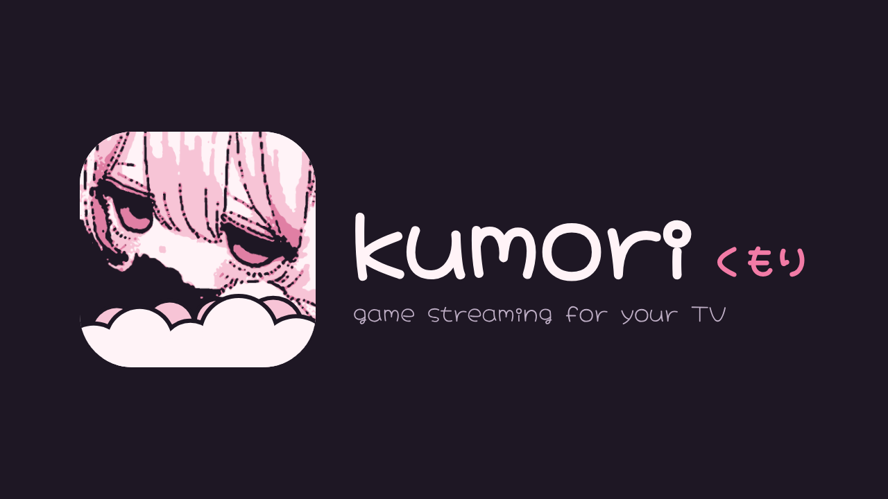

<p align="center">
  
</p>

Kumori is a GeForce NOW client for Android TV and Apple TV. It's built for the big screen, a remote and a controller.

It is not made by or affiliated with NVIDIA. You need your own GeForce NOW account.

## What it does

- Streams up to 4K at 120 fps on Android, and 4K at 60 fps on Apple TV, depending on your plan, device and TV
- One picker for resolution and refresh rate that shows what the stream is really running at
- AV1, HEVC and H.264 on Android. HEVC and H.264 on Apple TV
- Hardware decoding on both
- Works with a remote, a controller, or touch on Android

## Install

Grab the files from the [latest release](https://github.com/miirys/Kumori/releases/latest).

**Android TV:** install `Kumori-1.0.0.apk` with adb or any file manager.

```
adb install Kumori-1.0.0.apk
```

**Apple TV:** the IPA is not signed. I don't have a paid Apple developer account, so you have to sign it yourself. Sideloadly or Xcode with a free Apple ID both work. A free ID signs it for 7 days, then you sign it again.

## Build

Android needs JDK 17, the Android SDK with NDK 27.2.12479018 and CMake 3.22.1, and Rust.

```
cd android
python3 scripts/build_nvst.py
./gradlew :app:assembleRelease
```

Apple TV needs Xcode 16 and [XcodeGen](https://github.com/yonaskolb/XcodeGen).

```
cd tvos
xcodegen
open Kumori.xcodeproj
```

## What's tested

Both apps build in CI. That's it for now. See the release notes for what hasn't been tried on real hardware.

## License

MIT, see [LICENSE](LICENSE). Third-party code is listed in [THIRD_PARTY_NOTICES.md](THIRD_PARTY_NOTICES.md).
