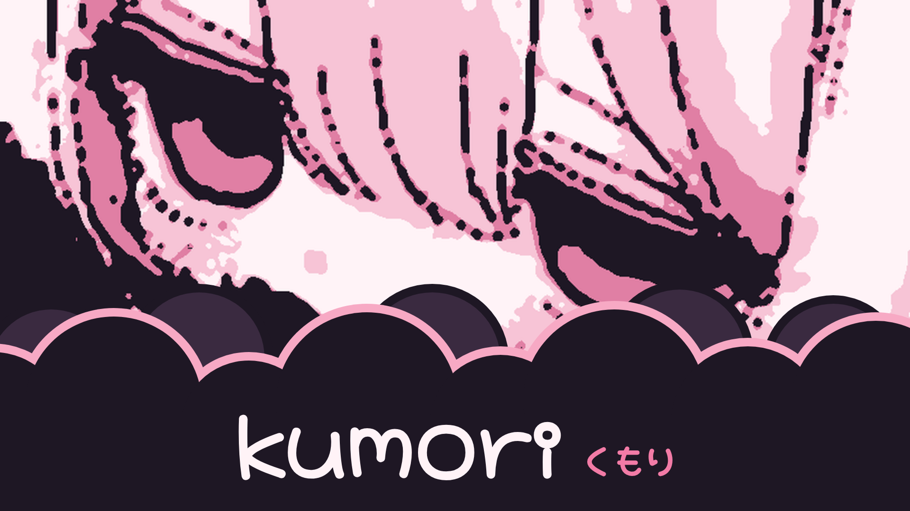

<p align="center">
  
</p>

<p align="center">
  <a href="https://github.com/miirys/Kumori/releases/latest"></a>
  <a href="https://github.com/miirys/Kumori/releases"></a>
  <a href="https://github.com/miirys/Kumori/actions/workflows/android.yml"></a>
  <a href="https://github.com/miirys/Kumori/actions/workflows/tvos.yml"></a>
  <a href="https://github.com/miirys/Kumori/stargazers"></a>
  <a href="LICENSE"></a>
</p>

Kumori is a GeForce NOW client for Android TV, Apple TV, Linux and Windows.

It is not made by or affiliated with NVIDIA. You need your own GeForce NOW account.

## What it does

- Plays your GeForce NOW library on the TV
- Up to 4K
- Works with a remote or a controller
- Looks the same on every platform
- On Linux and Windows: a mouse and keyboard layout, an optional gamepad layout, and a mouse pointer that is drawn on your own machine in the game's shape

## Install

Get the files from the [latest release](https://github.com/miirys/Kumori/releases/latest).

**Android TV:** the Android TV app is no longer developed; its last release is 1.2.1.

**Kumori Link (Android box):** install `KumoriLink-*.apk` with adb or a file manager on an Android box on the same network as the Apple TV. Controllers plugged into the box then play on the Apple TV, and on streams above 1080p60 the game's rumble reaches them too. See [the protocol](docs/kumori-link-protocol.md).

**Apple TV:** sideload the IPA. It's unsigned.

**Windows:** run the setup file, or unpack the zip and run `Kumori.exe`. The build is not signed, so SmartScreen asks once: choose More info, then Run anyway.

**Linux:** `chmod +x Kumori-*.AppImage` and run it, or unpack the tar.gz and run `kumori`. The AppImage needs FUSE 2 (`libfuse2`).

## Build

Android needs JDK 17, the Android SDK with NDK 27.2.12479018 and CMake 3.22.1, and Rust.

```
rustup target add aarch64-linux-android armv7-linux-androideabi
cd android
python3 scripts/build_nvst.py
./gradlew :app:assembleRelease
```

`build_nvst.py` builds the native library that 4K streams use. It finds the NDK through `ANDROID_HOME` or `local.properties`; pass the NDK path as the first argument if it is somewhere else. The Gradle release build stops if the library is missing.

Apple TV needs Xcode 16 and [XcodeGen](https://github.com/yonaskolb/XcodeGen).

```
cd tvos
xcodegen
open Kumori.xcodeproj
```

Linux and Windows need Node 22.

```
cd desktop
npm ci
npm start
npm run dist:linux   # or dist:win, on Windows
```

`npm test` checks the protocol code. `npm run e2e` drives the whole app against a stand-in rig.

## License

MIT, see [LICENSE](LICENSE). Third-party code is listed in [THIRD_PARTY_NOTICES.md](THIRD_PARTY_NOTICES.md).
